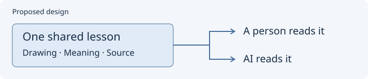

# Knowledge3D

Keep a lesson, diagram or model in one place so people and AI can refer to the same knowledge.
Knowledge3D explores shared knowledge in 3D spaces for researchers, developers and curious readers, including people without a technical background.

**Status:** the code is paused.
Work now focuses on the [specifications](docs/W3C/README.md) and reports for [PM-KR](https://www.w3.org/community/pm-kr/), a W3C community group studying how people and AI share knowledge.
These project drafts are proposals for discussion, not adopted W3C standards.

**Start here:** read the [explainer](docs/W3C/EXPLAINER.md) for the problem, the proposed first step and the questions still open.

## From form to meaning

The idea is to store knowledge once as procedures, instructions that describe how to make or do something, with people and AI reading it in the same place.

A font file is the working precedent.
Glyphs describe the shapes of letters; OpenType shaping rules combine and position them; Unicode identifies the characters those shapes represent.
The person sees a letter and software can identify it.
Character identity is a starting point for meaning; a font does not explain a whole concept.

The next proposed deliverable is a small “font file” repository for knowledge: a procedure for form, a SKOS term for meaning, and PROV records for origin and time.
SKOS names concepts and their relationships; PROV records where information came from.
This would sit alongside RDF, OWL and JSON-LD, the web's ways to describe and exchange linked knowledge.
Daniel's [28 October proposal](https://lists.w3.org/Archives/Public/public-pm-kr/2026Oct/0016.html) and [clarification](https://lists.w3.org/Archives/Public/public-pm-kr/2026Oct/0018.html) explain the font precedent and why each subject needs a useful stopping point for breaking knowledge into parts.

## Find your way

- **Standards:** the [document index](docs/W3C/README.md) labels drafts, discussion inputs and superseded texts.
- **Researchers:** the [use cases and open questions](docs/W3C/EXPLAINER.md#user-needs-and-use-cases) identify what needs testing.
- **Implementers:** the [proposed approach](docs/W3C/EXPLAINER.md#proposed-approach) connects the model, conformance drafts and exchange guide.
- **Take part:** the [PM-KR Community Group](https://www.w3.org/community/pm-kr/) is open to anyone with a W3C account, subject to its participation terms.

## Credits, licence and citation

Daniel Campos Ramos directs Knowledge3D, with AI assistance from Claude, Codex and the contributors credited in [Attributions](ATTRIBUTIONS.md).
The [project's influences](docs/POP_CULTURE_HERITAGE.md) are recorded separately.
Code is under [Apache 2.0](LICENSE); the white paper is under CC BY 4.0.
Cite the project using [CITATION.cff](CITATION.cff) and [DOI: 10.5281/zenodo.23308993](https://doi.org/10.5281/zenodo.23308993).
